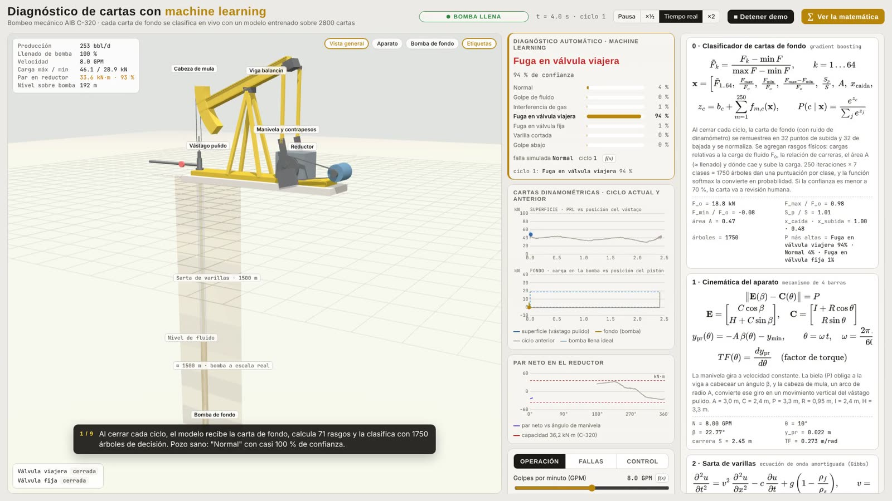
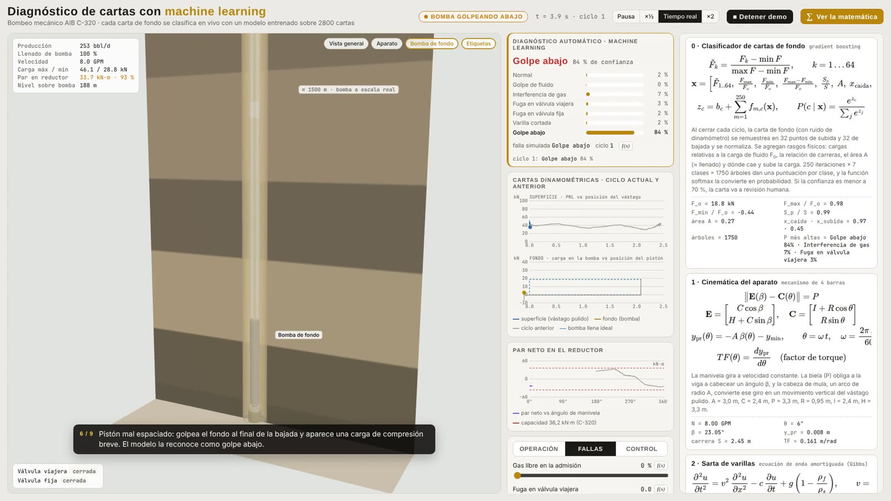
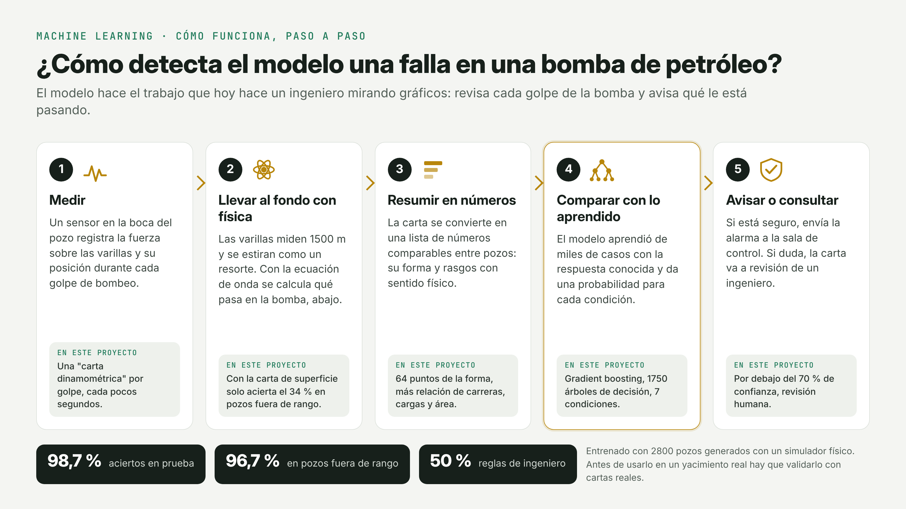
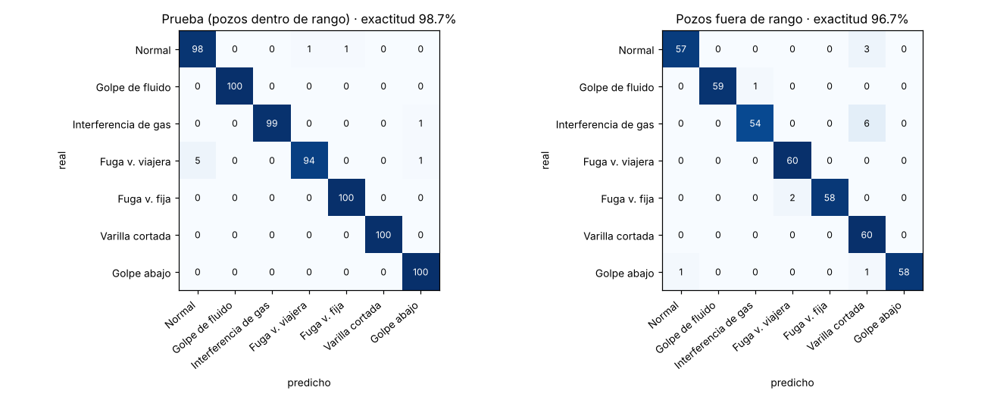
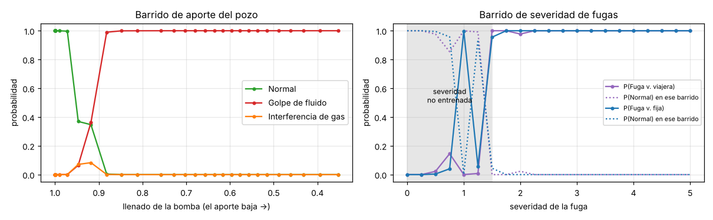

# Diagnóstico de cartas dinamométricas con machine learning

Clasificador automático de fallas de bombeo mecánico a partir de la **carta de fondo**. Este es un uso real de ML en
la producción de petróleo: los controladores de pozo y el SCADA registran una carta por ciclo, y el modelo marca
golpe de fluido, interferencia de gas, fugas en las válvulas, varilla cortada o bomba golpeando abajo, con una
probabilidad para cada clase.

Este ejercicio es independiente: no modifica el simulador de [`bombeo_mecanico/`](https://github.com/juanlaigle-hub/Simulations3D/tree/main/bombeo_mecanico) (repositorio `Simulations3D`). Usa una **copia de su núcleo
físico** para generar los datos (`datos/simulador_bombeo.js`).

<p> </p>

## Cómo funciona, en 5 pasos



**Notebook ejecutado:** [`notebook/entrenamiento_clasificador.ipynb`](notebook/entrenamiento_clasificador.ipynb), que se puede ver en GitHub con todos sus gráficos.

## Resultados

| Modelo | Exactitud en prueba | F1 macro | Exactitud en pozos fuera de rango |
|---|---|---|---|
| Reglas de ingeniero (llenado, carga máx./mín.) | 49,9 % | 0,38 | 46,7 % |
| **Gradient boosting** (desplegado) | **98,7 %** | **0,987** | **96,7 %** |
| Red neuronal MLP 64-32 | 99,0 % | 0,990 | 96,2 % |

Los pozos fuera de rango son más profundos (2250–2600 m), más rápidos (11–12,5 GPM) y tienen otros pistones y
fluidos. El modelo nunca los vio y aun así acierta el 96,7 %.

**¿Carta de fondo o de superficie?** El mismo modelo entrenado con la carta de **superficie** acierta el 89,9 % en
prueba, pero solo el **33,8 %** fuera de rango. La carta de superficie depende de la dinámica de la sarta de cada pozo.
Por eso la industria diagnostica con la carta de fondo, calculada con la ecuación de onda, y el análisis lo confirma
con datos.



## Fenomenología: cómo se verificó que todo respete la física

1. **Al generar los datos.** Cada muestra se descarta si su física no corresponde a la etiqueta (`fenomenologiaOK` en `datos/generar_dataset.js`):
   - golpe de fluido: llenado < 0,88;
   - interferencia de gas: llenado < 0,92;
   - fugas: al menos 8 % menos de producción que el mismo pozo sano;
   - varilla cortada: producción ≈ 0;
   - golpe abajo: carga de compresión < −3 kN.

   Se descartaron 476 casos de "golpe abajo" en los que el pistón no llegaba a tocar el fondo.
2. **Un error del simulador detectado por estos chequeos.** La fuga en la válvula viajera *aumentaba* la producción,
   porque el líquido que se fugaba se volvía a contar como producido. Se corrigió en el núcleo y también en
   [`bombeo_mecanico/`](https://github.com/juanlaigle-hub/Simulations3D/tree/main/bombeo_mecanico), en un commit separado. Ahora la producción baja con la severidad: 251 → 192 / 144 / 94 bbl/d.
3. **Antes de entrenar.** El notebook verifica con `assert` los promedios por clase: llenado, producción relativa y cargas.
4. **Después de entrenar, con barridos continuos.** Se usa un pozo que el modelo no vio:
   - el aporte baja de a poco: el modelo pasa de "normal" a "golpe de fluido" cuando el llenado cae por debajo
     de 0,88, justo donde lo indica la física;
   - la severidad de las fugas sube de 0 a 5: la probabilidad de la fuga correcta crece hasta 1.

   En severidades menores a las del entrenamiento el modelo duda, y eso se muestra.
5. **Explicabilidad.** Los rasgos más importantes son la relación de carreras pistón/superficie (varilla cortada),
   la carga mínima relativa (golpe abajo), la carga máxima y el área de la carta (llenado), todos con sentido físico.



## Paso a paso: cómo se hace esto en un yacimiento real

| Paso | En un proyecto real | En este ejercicio |
|---|---|---|
| **1. Definir el problema y el KPI** | Qué fallas importan, cuánto cuesta no detectarlas y cuánto una falsa alarma. Meta: recall alto en varilla cortada y fugas | 7 clases; se prioriza exhaustividad en las fallas críticas |
| **2. Conseguir los datos** | Exportar del SCADA o de los POC las cartas de superficie de meses de operación, con las condiciones de cada pozo (profundidad, varillas, pistón, GPM, nivel de fluido) | `datos/generar_dataset.js` simula 2800 pozos distintos con ruido de dinamómetro |
| **3. Calcular la carta de fondo** | Con la ecuación de onda de Gibbs a partir de la carta de superficie. Es software estándar en los sistemas de diagnóstico | El simulador entrega la carta de fondo directamente |
| **4. Etiquetar** | Ingenieros de producción etiquetan una muestra representativa y se cruzan las etiquetas con las intervenciones de pulling (lo que se encontró al sacar la bomba) | Etiquetas por construcción, con chequeos de fenomenología que descartan casos ambiguos |
| **5. Limpiar y normalizar** | Descartar cartas incompletas, remuestrear a puntos fijos, normalizar por la carga de fluido del pozo | Remuestreo 32 + 32 puntos y rasgos de escala relativos a $F_o$ |
| **6. Dividir los datos** | **Por pozo**, nunca al azar entre cartas del mismo pozo, para no filtrar información. Reservar un yacimiento o un período completo para la prueba final | Cada muestra es un pozo distinto, más un set de pozos fuera de rango |
| **7. Línea base** | Comparar contra las reglas que ya tiene el POC | Las reglas aciertan el 50 % |
| **8. Entrenar y comparar modelos** | Gradient boosting, redes neuronales y, con datos reales abundantes, redes convolucionales sobre la imagen de la carta | Gradient boosting y MLP |
| **9. Validar la física** | Revisar con especialistas las matrices de confusión, los rasgos importantes y los casos de borde | Barridos continuos, `assert` y explicabilidad |
| **10. Desplegar** | Exportar el modelo (ONNX, PMML o el formato del SCADA) y verificar que dé lo mismo que en Python. Correrlo al cerrar cada ciclo y enviar las alertas a la sala de control | Exportado a JSON (`modelo/clasificador_cartas.json`), verificado con diferencia 0 contra scikit-learn, y ejecutado en `clasificador.html` |
| **11. Umbral de confianza** | Si la probabilidad máxima es baja, la carta va a revisión humana | Umbral de 70 % |
| **12. Monitorear y reentrenar** | Vigilar la deriva de los rasgos mes a mes, registrar las correcciones de los ingenieros y reentrenar | Discutido en el notebook |

## Cómo usarlo

```bash
cd ml_cartas_dinamometricas/datos
node generar_dataset.js 400 7 base      # 2800 cartas (≈ 8 min)
node generar_dataset.js 60 99 fuera     # 420 cartas de pozos fuera de rango
node generar_dataset.js 1 5 barrido     # barridos para verificar la fenomenología
cd ../notebook
pip install -r ../requirements.txt
python construir_notebook.py entrenamiento_clasificador.py   # entrena, evalúa, exporta y guarda el .ipynb ejecutado
```

Después se abre `clasificador.html` en el navegador: es el simulador de bombeo con el panel "Diagnóstico automático
· machine learning". En cada ciclo muestra la clase predicha, la confianza, las 7 probabilidades y la falla que
está activa en la simulación, para comparar. La pestaña "Fallas" permite provocar cualquier falla, y el botón
"▶ Demo guiada" las recorre una por una.

## Archivos

| Archivo | Contenido |
|---|---|
| `datos/simulador_bombeo.js` | Copia del núcleo físico de bombeo (ecuación de onda, bomba, válvulas) |
| `datos/generar_dataset.js` | Generador del dataset con chequeos de fenomenología |
| `datos/dataset.csv`, `dataset_fuera_de_rango.csv`, `dataset_barrido.csv` | Datos generados (2800 + 420 + 73 cartas) |
| `notebook/entrenamiento_clasificador.py` / `.ipynb` | Entrenamiento, evaluación, fenomenología y exportación |
| `modelo/clasificador_cartas.json` | Modelo desplegable (1750 árboles) |
| `modelo/comparacion_modelos.csv` | Tabla de resultados |
| `figuras/` | Gráficos del notebook |
| `clasificador.html` | Simulador con el diagnóstico en vivo |

## Limitaciones

- Los datos son sintéticos. El modelo es un **punto de partida**: antes de usarlo en operación hay que medir su
  exactitud con cartas reales etiquetadas y reentrenarlo con ellas.
- Faltan fallas reales que el simulador no modela: barril gastado, pistón trabado, fricción en pozos desviados,
  fallas combinadas.
- Con baja presión de admisión, el gas libre produce cartas parecidas al golpe de fluido. Es una confusión real de la
  industria, y conviene cruzar el diagnóstico con el nivel de fluido medido (ecómetro).
