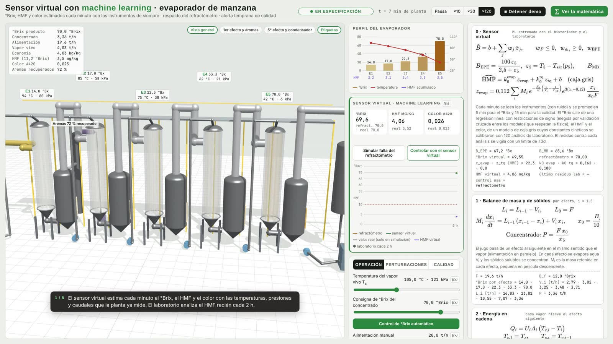
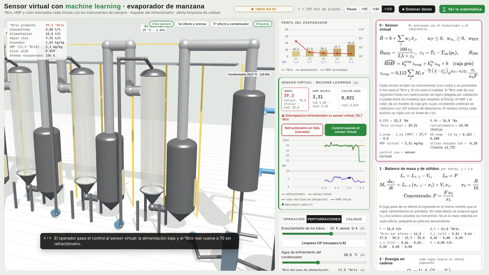
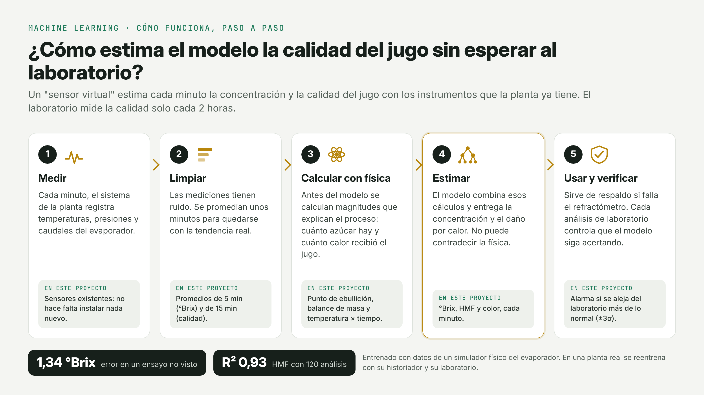

# Virtual sensor for °Brix, HMF and colour with machine learning · apple juice evaporator

[Versión en español](README.es.md)

A **virtual sensor** (*soft sensor*) for the juice plant that estimates three variables every minute from the
instruments the plant already has (temperatures, pressures and flows):
- the **concentrate °Brix**, as a backup for the in-line refractometer and to keep controlling if it fails;
- **HMF** and **colour**, which today are measured in the lab every few hours.

This exercise is standalone: it does not modify the simulator in [`evaporador_jugo/`](https://github.com/juanlaigle-hub/Simulations3D/tree/main/evaporador_jugo) (repository `Simulations3D`). It uses a **copy of its physics
core** to generate the data (`datos/simulador_evaporador.js`).

<p> </p>

## How it works, in 5 steps



**Executed notebook:** [`notebook/entrenamiento_sensor_virtual.ipynb`](notebook/entrenamiento_sensor_virtual.ipynb).

## Results

### Concentrate °Brix
The model is chosen by **cross-validation grouped by campaign** among those that pass the physical tests, without
looking at the test set. Errors are against the true °Brix, which is only known because the data is simulated.

| Model | Cross-validation MAE | +10 % feed → drops | +10 % steam → rises | Test MAE | Trial B MAE (unseen) |
|---|---|---|---|---|---|
| Naive (°Brix = setpoint 70) | 0.77 | — | — | 0.75 | 6.45 |
| Physical (5th-effect BPE + mass balance) | 1.29 | 100 % | 99.99 % | 1.17 | 2.44 |
| Ridge (sensors + physical features) | 0.63 | 99.99 % | **22.9 %** ✗ | 0.58 | 1.42 |
| Monotonic gradient boosting | 0.94 | 99.9 % | 99.9 % | 0.71 | 3.10 |
| **Sign-constrained linear** (deployed) | **0.66** | **100 %** | **100 %** | **0.61** | **1.34** |

Ridge has a good average error but **gives a negative coefficient to the mass-balance °Brix**, because of collinearity
between variables, and fails the steam test. With sign constraints (°Brix only rises with steam and with the physical
features, and only drops with feed), the error is practically the same and the physics is always respected.

### HMF and colour
With only **120 lab analyses** for training:

| Variable | Model | MAE | R² |
|---|---|---|---|
| HMF | Gradient boosting on raw sensors | 0.46 mg/kg | 0.90 |
| HMF | Ridge on raw sensors | 0.35 mg/kg | 0.93 |
| HMF | Arrhenius per effect (6 free coefficients) | 0.32 mg/kg | 0.95 |
| HMF | **Grey box (2 kinetic constants)** (deployed) | **0.41 mg/kg** | **0.93** |
| Colour | Gradient boosting on raw sensors | 0.0037 | 0.69 |
| Colour | Ridge on raw sensors | 0.0045 | 0.72 |
| Colour | **Grey box** (deployed) | **0.0022** | **0.95** |

For HMF, the grey box does not have the lowest average error, but it is the one deployed for three reasons:
- **Its constants are physically meaningful.** The model with 6 free coefficients gives impossible values (0 for two
  effects and 16.7 for another).
- **It needs far fewer analyses.** With only 20 it has an MAE of 0.43 mg/kg; gradient boosting needs 120 to reach 0.46.
- **It extrapolates with the physics.** At +10 °C, HMF rises in 100 % of cases, versus 98.2 % for gradient boosting,
  which cannot extrapolate.

For colour it is also the best by a wide margin.


## Phenomenology: how it was verified that everything respects the physics

1. **Data.** Three correlations are checked before modelling:
   - HMF rises with steam temperature (Arrhenius, r = +0.72);
   - in the trials, more feed gives lower °Brix (mass balance, r = −0.64);
   - the 5th-effect boiling-point elevation grows with °Brix (r = +0.43 with raw data, +0.79 filtered).
2. **Simulator bugs found by these checks and fixed** in [`evaporador_jugo/`](https://github.com/juanlaigle-hub/Simulations3D/tree/main/evaporador_jugo), in separate commits:
   - **With very low feed**, °Brix dropped from one effect to the next. The minimum wetting rate (10 t/h) was added.
   - **Near 80 °Brix**, temperatures jumped between two solutions of the energy chain and produced artificial HMF
     spikes. The drop of U with viscosity and the high-°Brix interlock (76) were added.
   - **The trials triggered that interlock** and °Brix stopped responding to feed. They were redesigned with moderate
     steam, the way a real plant trial is planned.
3. **Physics-based features.**
   - **°Brix from BPE:** $\text{BPE} = 2.5\,B/(100-B)$ is inverted using $T_5 - T_{\text{sat}}(p_5)$.
   - **°Brix from mass balance:** $F B_f/(F - E\dot m_s)$.
   - **HMF from Arrhenius:** the reaction rate times the residence time of the solids in each effect, with the design
     hold-up masses.
4. **Physically meaningful constants.** The HMF grey-box model calibrates the kinetic constant against the lab and gets
   0.162 (evaporator) and 0.188 (tank), versus 0.18 in the simulator. For colour it gets 0.00097 and 0.00114, versus
   0.0011. In a real plant, this value is compared with the literature.
5. **Sensitivity tests** on the data: +10 °C → HMF rises; +10 % feed → °Brix drops; +10 % steam → °Brix rises. The
   deployed models pass them in 100 % of cases.
6. **Monitoring.** The lab − prediction residual is watched with a ±3σ limit (σ = 0.58 mg/kg). In the test campaigns it
   stays within the limit even as the tubes foul.

## Step by step: how this is done in a real juice plant

| Step | In a real plant | In this exercise |
|---|---|---|
| **1. Define the problem and the KPI** | Which variable is missing, with what accuracy, and what decision is made with it (keep controlling without the refractometer, hold batches, adjust steam) | °Brix ± 1 as a control backup; HMF with an error smaller than the lab's between analyses |
| **2. Extract the historian** | Export months of minute data from PI, the SCADA historian or the DCS, with the instrument tags | `datos/generar_campanas.js`: 14 campaigns of 24 h with instrument noise |
| **3. Gather the lab data** | HMF and colour analyses with their exact sampling time (not the time the result was entered!) | 176 analyses every 2 h, with 5 % error |
| **4. Plan plant trials** | In closed loop, °Brix barely varies and the data does not teach cause and effect. Feed steps are made in manual, coordinated with production and designed **not to trigger the plant's protections** | 2 trial campaigns of 8 h with moderate steam; without them, the °Brix sensor did not beat "°Brix = setpoint" |
| **5. Clean and align** | Filter noise (moving averages), discard shutdowns, CIP and start-ups, and align the lab with the process according to residence time | 5 min averages (°Brix) and 15 min (quality) |
| **6. Design physics-based features** | BPE, balances, Arrhenius and residence times with the equipment design data | See the phenomenology section |
| **7. Split by time** | Train on the past and test on the future. A random split mixes neighbouring minutes and gives misleading metrics | Training: campaigns 1–10 + trial A. Test: campaigns 11–14 + trial B |
| **8. Baseline, models and selection** | Start simple (physics, PLS, Ridge), add complexity only if it helps, and choose by grouped cross-validation, never by looking at the test set | Naive → physical → Ridge → gradient boosting → sign-constrained linear (chosen); grey box for quality |
| **9. Validate the physics** | Sensitivity tests with the process engineers: if a prediction goes against the physics, the model is not used | Sensitivities, monotonicity and kinetic constants |
| **10. Deploy to the DCS or SCADA** | Export the model (ONNX, code in the controller or an inference server) and check it gives the same result as in Python | `modelo/sensor_virtual.json`, verified with zero difference, and run in `sensor_virtual.html` |
| **11. Operation with backup** | Discrepancy alarm between refractometer and virtual sensor; option to control with the virtual sensor if the refractometer fails | "Simulate refractometer failure" and "Control with the virtual sensor" buttons |
| **12. Monitor and recalibrate** | Each lab analysis is compared with the virtual sensor; if the residual leaves ±3σ, it is recalibrated | ±3σ limit on the page |

## How to use it

```bash
cd ml_sensor_virtual_evaporador/datos
node generar_campanas.js 14 24 11 2     # 14 campaigns of 24 h + 2 trials of 8 h (≈ 1 min)
cd ../notebook
pip install -r ../requirements.txt
python construir_notebook.py entrenamiento_sensor_virtual.py
```

Then open `sensor_virtual.html`: it is the evaporator with the "Virtual sensor · machine learning" panel. The panel
shows, live:
- virtual °Brix, HMF and colour;
- the refractometer reading;
- lab analyses every 2 plant hours;
- the true value, which does not exist in a plant and is shown here only for evaluation.

The buttons simulate a refractometer failure and hand control over to the virtual sensor.

## Files

| File | Contents |
|---|---|
| `datos/simulador_evaporador.js` | Copy of the evaporator physics core |
| `datos/generar_campanas.js` | Historian and lab data generator |
| `datos/historico.csv`, `laboratorio.csv` | 21,136 process minutes and 176 analyses |
| `notebook/entrenamiento_sensor_virtual.py` / `.ipynb` | Training, comparison, phenomenology and export |
| `modelo/sensor_virtual.json` | Deployable model |
| `modelo/*.csv` | Results tables, kinetic constants and phenomenology checks |
| `figuras/` | Notebook plots |
| `sensor_virtual.html` | Evaporator with the live virtual sensor |

## Limitations

- The data is simulated. In a plant, the model is retrained with its own historian and lab. What transfers is the
  **methodology**: physical features, trials, time-based split, monotonicity constraints and phenomenology checks.
- °Brix from BPE depends on measuring the 5th-effect pressure well: at 6 kPa, a 0.3 kPa error is almost 0.6 °C of
  saturation temperature.
- The virtual sensor does not replace the lab: it complements it between analyses, and each analysis serves to check it.
- The HMF and colour models use a 15 min average, consistent with the residence time. In a fast transient, such as the
  feed change when control passes to the virtual sensor, the estimate lags the true value by a few minutes.
- Beyond about 76 °Brix the interlock acts. The evaporator model is not valid in over-concentration, so the data does
  not include that zone.
