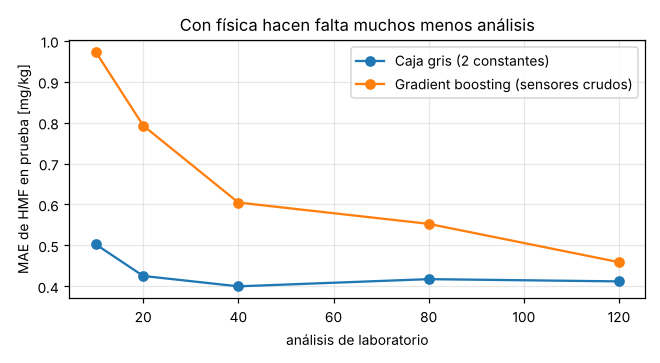

# Sensor virtual de °Brix, HMF y color con machine learning · evaporador de jugo de manzana

Un **sensor virtual** (*soft sensor*) para la juguera, que estima cada minuto tres variables con los instrumentos que
la planta ya tiene (temperaturas, presiones y caudales):
- el **°Brix del concentrado**, como respaldo del refractómetro en línea y para seguir controlando si este falla;
- el **HMF** y el **color**, que hoy se miden en laboratorio cada pocas horas.

Este ejercicio es independiente: no modifica el simulador de [`evaporador_jugo/`](https://github.com/juanlaigle-hub/Simulations3D/tree/main/evaporador_jugo) (repositorio `Simulations3D`). Usa una **copia de su núcleo
físico** para generar los datos (`datos/simulador_evaporador.js`).

**Video de la demo:** [`demo_sensor_virtual.mp4`](demo_sensor_virtual.mp4) (160 s).
**Notebook ejecutado:** [`notebook/entrenamiento_sensor_virtual.ipynb`](notebook/entrenamiento_sensor_virtual.ipynb).

## Resultados

### °Brix del concentrado
El modelo se elige por **validación cruzada agrupada por campaña** entre los que pasan las pruebas físicas, sin mirar la
prueba. Los errores son contra el °Brix real, que solo se conoce porque los datos son simulados.

| Modelo | MAE validación cruzada | +10 % alim. → baja | +10 % vapor → sube | MAE prueba | MAE ensayo B (no visto) |
|---|---|---|---|---|---|
| Ingenuo (°Brix = consigna 70) | 0,77 | — | — | 0,75 | 6,45 |
| Físico (EPE del 5º efecto + balance de masa) | 1,29 | 100 % | 99,99 % | 1,17 | 2,44 |
| Ridge (sensores + rasgos físicos) | 0,63 | 99,99 % | **22,9 %** ✗ | 0,58 | 1,42 |
| Gradient boosting monótono | 0,94 | 99,9 % | 99,9 % | 0,71 | 3,10 |
| **Lineal con restricciones de signo** (desplegado) | **0,66** | **100 %** | **100 %** | **0,61** | **1,34** |

El Ridge tiene buen error promedio pero **le da coeficiente negativo al °Brix por balance de masa**, por la colinealidad
entre variables, y falla la prueba del vapor. Con restricciones de signo (el °Brix solo sube con el vapor y con los
rasgos físicos, y solo baja con la alimentación), el error es prácticamente el mismo y la física se respeta siempre.

### HMF y color
Con solo **120 análisis de laboratorio** para entrenar:

| Variable | Modelo | MAE | R² |
|---|---|---|---|
| HMF | Gradient boosting sobre sensores crudos | 0,46 mg/kg | 0,90 |
| HMF | Ridge sobre sensores crudos | 0,35 mg/kg | 0,93 |
| HMF | Arrhenius por efecto (6 coeficientes libres) | 0,32 mg/kg | 0,95 |
| HMF | **Caja gris (2 constantes cinéticas)** (desplegado) | **0,41 mg/kg** | **0,93** |
| Color | Gradient boosting sobre sensores crudos | 0,0037 | 0,69 |
| Color | Ridge sobre sensores crudos | 0,0045 | 0,72 |
| Color | **Caja gris** (desplegado) | **0,0022** | **0,95** |

Para el HMF, la caja gris no es la de menor error promedio, pero es la que se despliega por tres razones:
- **Sus constantes tienen sentido físico.** El modelo con 6 coeficientes libres da valores imposibles (0 para dos
  efectos y 16,7 para otro).
- **Necesita muchos menos análisis.** Con solo 20, tiene un MAE de 0,43 mg/kg; el gradient boosting necesita 120 para
  llegar a 0,46.
- **Extrapola con la física.** Con +10 °C, el HMF sube en el 100 % de los casos, contra el 98,2 % del gradient
  boosting, que no puede extrapolar.

En el color es además el mejor por amplio margen.



## Fenomenología: cómo se verificó que todo respete la física

1. **Datos.** Antes de modelar se verifican tres correlaciones:
   - el HMF sube con la temperatura del vapor (Arrhenius, r = +0,72);
   - en los ensayos, más alimentación da menos °Brix (balance de masa, r = −0,64);
   - la elevación del punto de ebullición del 5º efecto crece con el °Brix (r = +0,43 con datos crudos, +0,79 filtrados).
2. **Errores del simulador encontrados por estos chequeos y corregidos** en [`evaporador_jugo/`](https://github.com/juanlaigle-hub/Simulations3D/tree/main/evaporador_jugo), en commits separados:
   - **Con muy poca alimentación**, el °Brix bajaba de un efecto al siguiente. Se agregó el caudal mínimo de mojado
     (10 t/h).
   - **Cerca de 80 °Brix**, las temperaturas saltaban entre dos soluciones de la cadena de energía y daban picos de HMF
     artificiales. Se agregaron la caída de U con la viscosidad y el enclavamiento de °Brix alto (76).
   - **Los ensayos activaban ese enclavamiento** y el °Brix dejaba de responder a la alimentación. Se rediseñaron con
     vapor moderado, como se planifica un ensayo real.
3. **Rasgos con física.**
   - **°Brix por EPE:** se invierte $\text{EPE} = 2{,}5\,B/(100-B)$ usando $T_5 - T_{\text{sat}}(p_5)$.
   - **°Brix por balance de masa:** $F B_f/(F - E\dot m_s)$.
   - **HMF por Arrhenius:** la velocidad de reacción por el tiempo de residencia de los sólidos en cada efecto, con las
     masas retenidas de diseño.
4. **Constantes con sentido físico.** El modelo de caja gris del HMF calibra la constante cinética con el laboratorio y
   obtiene 0,162 (evaporador) y 0,188 (tanque), contra 0,18 del simulador. En el color obtiene 0,00097 y 0,00114, contra
   0,0011. En una planta real, este valor se compara con la bibliografía.
5. **Pruebas de sensibilidad** sobre los datos: +10 °C → el HMF sube; +10 % de alimentación → el °Brix baja; +10 % de
   vapor → el °Brix sube. Los modelos desplegados las pasan en el 100 % de los casos.
6. **Monitoreo.** El residuo laboratorio − predicción se vigila con un límite de ±3σ (σ = 0,58 mg/kg). En las
   campañas de prueba queda dentro del límite aunque los tubos se ensucien.

## Paso a paso: cómo se hace esto en una juguera real

| Paso | En una planta real | En este ejercicio |
|---|---|---|
| **1. Definir el problema y el KPI** | Qué variable falta medir, con qué precisión y qué decisión se toma con ella (seguir controlando sin refractómetro, retener lotes, ajustar el vapor) | °Brix ± 1 como respaldo del control; HMF con error menor al del laboratorio entre análisis |
| **2. Extraer el historiador** | Exportar de PI, el historiador del SCADA o el DCS meses de datos cada minuto, con las etiquetas de los instrumentos | `datos/generar_campanas.js`: 14 campañas de 24 h con ruido de instrumentos |
| **3. Juntar el laboratorio** | Análisis de HMF y color con su hora de muestreo exacta (¡no la hora en que se cargó el resultado!) | 176 análisis cada 2 h, con 5 % de error |
| **4. Planificar ensayos en planta** | En lazo cerrado el °Brix casi no varía y los datos no enseñan la relación causa-efecto. Se hacen escalones de alimentación en manual, coordinados con producción y diseñados para **no activar las protecciones** de la planta | 2 campañas de ensayo de 8 h con vapor moderado; sin ellas, el sensor de °Brix no le ganaba a "°Brix = consigna" |
| **5. Limpiar y alinear** | Filtrar ruido (promedios móviles), descartar paradas, CIP y arranques, y alinear el laboratorio con el proceso según el tiempo de residencia | Promedios de 5 min (°Brix) y 15 min (calidad) |
| **6. Diseñar rasgos con física** | EPE, balances, Arrhenius y tiempos de residencia con los datos de diseño del equipo | Ver la sección de fenomenología |
| **7. Dividir por tiempo** | Entrenar con el pasado y probar con el futuro. Partir al azar mezcla minutos vecinos y da métricas engañosas | Entrenamiento: campañas 1–10 + ensayo A. Prueba: campañas 11–14 + ensayo B |
| **8. Línea base, modelos y selección** | Empezar por lo simple (física, PLS, Ridge), sumar complejidad solo si mejora y elegir por validación cruzada agrupada, nunca mirando la prueba | Ingenuo → físico → Ridge → gradient boosting → lineal con signos (elegido); caja gris para la calidad |
| **9. Validar la física** | Pruebas de sensibilidad con los ingenieros de proceso: si una predicción va contra la física, el modelo no se usa | Sensibilidades, monotonía y constantes cinéticas |
| **10. Desplegar en el DCS o SCADA** | Exportar el modelo (ONNX, código en el controlador o un servidor de inferencia) y verificar que dé lo mismo que en Python | `modelo/sensor_virtual.json`, verificado con diferencia 0, y ejecutado en `sensor_virtual.html` |
| **11. Operación con respaldo** | Alarma de discrepancia entre refractómetro y sensor virtual; opción de controlar con el sensor virtual si el refractómetro falla | Botones "Simular falla del refractómetro" y "Controlar con el sensor virtual" |
| **12. Monitorear y recalibrar** | Cada análisis de laboratorio se compara con el sensor virtual; si el residuo sale de ±3σ, se recalibra | Límite de ±3σ en la página |

## Cómo usarlo

```bash
cd ml_sensor_virtual_evaporador/datos
node generar_campanas.js 14 24 11 2     # 14 campañas de 24 h + 2 ensayos de 8 h (≈ 1 min)
cd ../notebook
pip install -r ../requirements.txt
python construir_notebook.py entrenamiento_sensor_virtual.py
```

Después se abre `sensor_virtual.html`: es el evaporador con el panel "Sensor virtual · machine learning". El panel
muestra, en vivo:
- °Brix, HMF y color virtuales;
- la lectura del refractómetro;
- los análisis de laboratorio cada 2 h de planta;
- el valor real, que en una planta no existe y aquí se muestra solo para evaluar.

Con los botones se puede simular la falla del refractómetro y pasar el control al sensor virtual.

## Archivos

| Archivo | Contenido |
|---|---|
| `datos/simulador_evaporador.js` | Copia del núcleo físico del evaporador |
| `datos/generar_campanas.js` | Generador del historiador y del laboratorio |
| `datos/historico.csv`, `laboratorio.csv` | 21 136 minutos de proceso y 176 análisis |
| `notebook/entrenamiento_sensor_virtual.py` / `.ipynb` | Entrenamiento, comparación, fenomenología y exportación |
| `modelo/sensor_virtual.json` | Modelo desplegable |
| `modelo/*.csv` | Tablas de resultados, constantes cinéticas y chequeos de fenomenología |
| `figuras/` | Gráficos del notebook |
| `sensor_virtual.html` | Evaporador con el sensor virtual en vivo |
| `demo_sensor_virtual.mp4` | Video de la demo guiada |

## Limitaciones

- Los datos son simulados. En una planta, el modelo se reentrena con su historiador y su laboratorio. Lo que se
  transfiere es la **metodología**: rasgos físicos, ensayos, partición temporal, restricciones de monotonía y
  chequeos de fenomenología.
- El °Brix por EPE depende de medir bien la presión del 5º efecto: a 6 kPa, un error de 0,3 kPa equivale a casi
  0,6 °C de temperatura de saturación.
- El sensor virtual no reemplaza al laboratorio: lo complementa entre análisis, y cada análisis sirve para controlarlo.
- Los modelos de HMF y color usan un promedio de 15 min, coherente con el tiempo de residencia. En un transitorio rápido,
  como el cambio de alimentación al pasar el control al sensor virtual, la estimación se atrasa unos minutos respecto
  del valor real.
- Más allá de unos 76 °Brix actúa el enclavamiento. El modelo del evaporador no es válido en sobreconcentración, así
  que los datos no incluyen esa zona.
